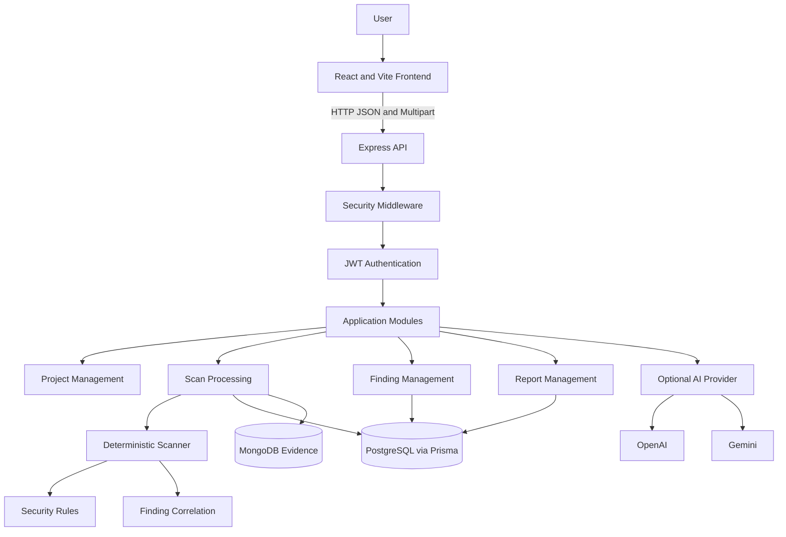

# High-Level Design (HLD)

## 1. Project Overview

MISCONFIG is a security configuration intelligence platform that identifies potentially insecure configurations, explains their risks, correlates related findings, and provides remediation guidance before deployment.

The platform uses deterministic security rules as its primary detection mechanism. Optional AI integration provides additional advisory explanations without changing the scanner results.

## 2. System Architecture

MISCONFIG follows a TypeScript modular monolith architecture.

### Technology Stack

| Layer | Technology | Responsibility |
|---|---|---|
| Frontend | React, TypeScript, Vite | User interface and dashboard |
| Backend | Node.js, Express, TypeScript | API and application logic |
| Authentication | JWT, bcryptjs | User authentication |
| Validation | Zod | Request validation |
| Primary database | PostgreSQL, Prisma | Relational application records |
| Evidence database | MongoDB, Mongoose | Scan evidence and observations |
| Scanner | TypeScript rule engine | Configuration security analysis |
| AI integration | OpenAI or Gemini | Optional advisory explanations |
| Security middleware | Helmet, CORS, express-rate-limit | API protection |
| Upload processing | Multer, AdmZip | File and ZIP processing |

## 3. Architecture Diagram

## 4. Major Components

### 4.1 Frontend
The React and Vite application provides:
- User registration and login.
- Project management.
- Configuration file uploads.
- Scan results and security findings.
- Risk scenario visualization.
- Finding remediation status management.
- Evidence review.
- Security report generation.
- AI-assisted explanations.
- Profile and application settings.

### 4.2 Backend API
The Express backend handles:
- Authentication and authorization.
- Project and scan operations.
- Upload validation and processing.
- Security analysis.
- Finding and risk scenario persistence.
- Evidence management.
- Report generation and downloads.
- Optional AI requests.

The backend is organized as a modular monolith rather than independent microservices.

### 4.3 Scanner Engine
The scanner reads supported configuration files as text and applies deterministic pattern-based rules.

Current detection categories include:
- Secret-like values.
- Debug mode enabled.
- Permissive CORS.
- Privileged containers.
- Published database ports.
- Containers running as root.
- Broad filesystem permissions.

The scanner also calculates SHA-256 hashes and creates redacted evidence observations.

### 4.4 Correlation Engine
The correlation engine identifies predefined combinations of findings within the same scan.

Current scenarios:
- Exposed database with inline credentials.
- Debug mode with a published database port.
- Privileged container with broad permissions.

A scenario is created only when every required finding is present.

### 4.5 AI Integration
The platform optionally connects to OpenAI or Gemini.

AI is used to provide advisory explanations and remediation guidance for existing findings. It does not generate or modify deterministic scanner findings.

## 5. Database Architecture

MISCONFIG uses two databases for different responsibilities.

### PostgreSQL
PostgreSQL is the authoritative relational database. Prisma manages its schema and queries.

It stores:
- Users.
- Projects.
- Scans and scanned file paths.
- Security findings.
- Risk scenarios and their relationships.
- Remediation history.
- Report metadata.

### MongoDB
MongoDB stores flexible scan evidence and configuration observations.

Evidence includes:
- Scan identifier.
- File path.
- SHA-256 file hash.
- Security observations.
- Redacted evidence.
- Optional review notes.

The MongoDB evidence store does not need to contain the original uploaded source files.

## 6. High-Level Data Flow

1. A user authenticates and receives a JWT.
2. The user creates a project.
3. The user uploads supported configuration files or a ZIP archive.
4. The API validates the project ownership and uploaded files.
5. The scanner inspects the file contents without executing them.
6. Matching rules produce security findings.
7. The correlation engine identifies predefined combinations of findings.
8. Findings and scenarios are persisted in PostgreSQL.
9. Redacted evidence and observations are stored in MongoDB.
10. The scan is marked completed and its results are returned to the frontend.
11. The user can review findings, update remediation status, request optional AI advice, and generate reports.

## 7. Security Design

The application incorporates:
- Password hashing with bcrypt.
- JWT-based authentication with an eight-hour expiration.
- User ownership checks for protected resources.
- Helmet security headers.
- Configured CORS origin.
- API rate limiting.
- Zod request validation.
- File count and file size limits.
- ZIP path and nesting validation.
- YAML and JSON syntax validation.
- Evidence redaction before persistence.
- Server-side storage of AI provider keys.

Uploaded files are inspected as text and are never executed.

## 8. Reliability and Error Handling

The scan process creates a RUNNING record before processing.

Findings and risk scenarios are saved in a PostgreSQL transaction. Evidence is then stored in MongoDB.

When evidence persistence fails, the application attempts to remove evidence and delete the related PostgreSQL scan tree. The scan is marked FAILED and the request returns an error.

For production evolution, a durable outbox and reconciliation worker are recommended to handle process termination during cross-database writes.

## 9. Deployment Architecture

The application can run locally using:
- Node.js and npm.
- PostgreSQL.
- MongoDB.
- Docker Desktop for local database services.
- A browser for the React frontend.

The frontend uses port 5173 and the API uses port 4000 by default.

## 10. Design Constraints

- Detection depends on explicitly implemented patterns.
- Pattern-based results are not a guarantee that every vulnerability will be detected.
- AI advice is optional and advisory.
- Evidence redaction is best effort.
- The current scan processing is synchronous.
- Production deployment should introduce stronger operational monitoring and durable cross-database reconciliation.
