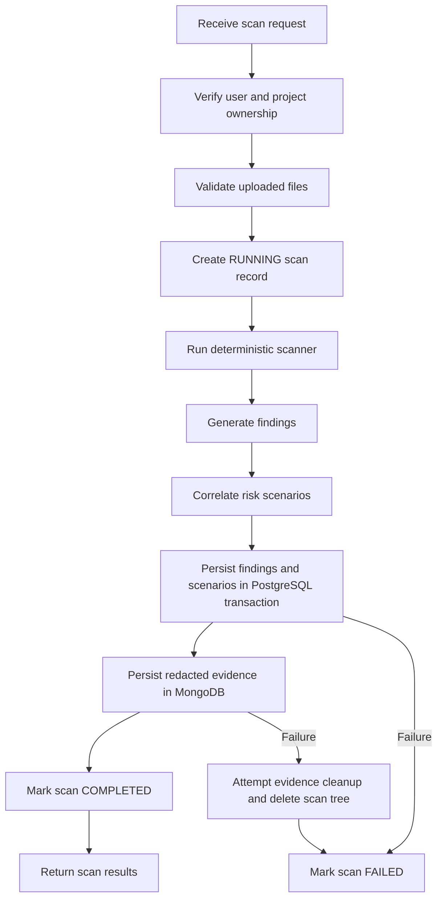

# Low-Level Design (LLD)

## 1. Introduction

This document describes the internal implementation of MISCONFIG, including its API endpoints, application modules, database models, scanner logic, validation, authentication, and persistence workflow.

## 2. Backend Structure

The backend is implemented using Node.js, Express, and TypeScript.

Important implementation files:

| File | Responsibility |
|---|---|
| apps/api/src/server.ts | Express application, middleware and API routes |
| apps/api/src/config.ts | Environment configuration |
| apps/api/src/scanner/engine.ts | Deterministic scanner and correlation engine |
| apps/api/src/database/index.ts | PostgreSQL and MongoDB integration |
| apps/api/src/modules/projects.repository.ts | Project summary database operations |
| apps/api/src/providers/ai.ts | AI provider integration |

## 3. Authentication and Authorization

### Registration

Endpoint: POST /api/auth/register

1. Validate name, email, and password using Zod.
2. Normalize the email to lowercase.
3. Check whether the email already exists.
4. Hash the password using bcrypt with 12 salt rounds.
5. Create the user in PostgreSQL.
6. Generate a JWT with the user ID as its subject.
7. Return the token and public user information.

Password requirements:
- Minimum 10 characters.
- Maximum 128 characters.

### Login

Endpoint: POST /api/auth/login

1. Validate email and password.
2. Retrieve the user by normalized email.
3. Compare the submitted password with the stored bcrypt hash.
4. Return an authentication error if credentials are invalid.
5. Generate an eight-hour JWT when authentication succeeds.

### Authentication Middleware

The auth middleware:
- Reads the Authorization header.
- Requires the Bearer token format.
- Verifies the JWT using the server secret.
- Extracts the user ID from the token subject.
- Rejects missing, expired, or invalid tokens with HTTP 401.

Protected API routes use user ownership checks to prevent access to another user's projects, scans, findings, and reports.

## 4. Security Middleware

The Express application uses:

| Middleware | Purpose |
|---|---|
| Helmet | Sets HTTP security headers |
| CORS | Restricts cross-origin access to the configured frontend origin |
| express.json | Parses JSON requests with a 1 MB limit |
| express-rate-limit | Limits API requests to 120 per minute |
| Authentication middleware | Verifies user identity on protected routes |
| Zod | Validates request bodies and accepted values |
| Multer | Handles multipart file uploads |

## 5. API Design

All application API endpoints use the /api prefix.

### 5.1 Authentication

| Method | Endpoint | Purpose | Access |
|---|---|---|---|
| POST | /api/auth/register | Register a user | Public |
| POST | /api/auth/login | Authenticate a user | Public |
| GET | /api/auth/me | Retrieve current user | Authenticated |

### 5.2 Dashboard and Projects

| Method | Endpoint | Purpose |
|---|---|---|
| GET | /api/dashboard | Retrieve dashboard statistics |
| GET | /api/projects | List the user's projects |
| POST | /api/projects | Create a project |
| GET | /api/projects/:projectId | Retrieve a project |
| GET | /api/projects/:projectId/summary | Retrieve project summary |
| PATCH | /api/projects/:projectId | Update a project |
| DELETE | /api/projects/:projectId | Delete a project |

### 5.3 Scanning and Findings

| Method | Endpoint | Purpose |
|---|---|---|
| POST | /api/projects/:projectId/scans | Upload files and execute a scan |
| GET | /api/projects/:projectId/scans | List project scans |
| GET | /api/scans/:scanId | Retrieve scan details |
| GET | /api/scans/:scanId/findings | List scan findings |
| GET | /api/findings/:findingId | Retrieve a finding |
| PATCH | /api/findings/:findingId/status | Update finding status |

### 5.4 Scenarios and Evidence

| Method | Endpoint | Purpose |
|---|---|---|
| GET | /api/scans/:scanId/scenarios | List risk scenarios |
| GET | /api/scenarios/:scenarioId | Retrieve scenario details |
| GET | /api/scans/:scanId/evidence | Retrieve scan evidence |
| PATCH | /api/scans/:scanId/evidence/:path | Update evidence review note |

### 5.5 AI, Reports, and Settings

| Method | Endpoint | Purpose |
|---|---|---|
| POST | /api/ai/explain | Request AI explanation |
| POST | /api/ai/remediate | Request AI remediation advice |
| GET | /api/scans/:scanId/reports | List scan reports |
| POST | /api/scans/:scanId/reports | Create report metadata |
| GET | /api/reports/:reportId | Retrieve report |
| GET | /api/reports/:reportId/download | Download report |
| GET | /api/settings | Retrieve application settings |
| PATCH | /api/settings/profile | Update profile |

Protected endpoints require a valid Bearer token.

## 6. File Upload Processing

The scanning endpoint accepts multipart uploads using the field name files.

Multer configuration:
- Memory storage.
- Maximum 25 uploaded files per request.
- Per-file limit controlled by MAX_UPLOAD_MB.

Supported file types include:
- Dockerfile and .dockerfile.
- YAML and YML.
- JSON.
- CONF and CONFIG.
- Terraform .tf.
- .env.example.

Real .env files are not accepted as supported scan inputs.

### ZIP Validation

ZIP archives are checked for:
- Maximum 100 archive entries.
- Maximum nesting depth of 8.
- Maximum expanded size of 20 MB.
- Maximum extracted file size of 2 MB.
- Absolute paths and drive-prefixed paths.
- Null bytes and parent-directory traversal.
- Duplicate supported file paths.
- Supported file types.

YAML files are parsed using js-yaml. JSON files are parsed using JSON.parse. Invalid syntax produces a validation error.

Uploaded files are treated as text and are not executed.

## 7. Scanner Engine

The scanner is implemented in apps/api/src/scanner/engine.ts.

### 7.1 Input

The scanner receives an array of InputFile objects:

- path: relative file path.
- content: file content as text.

### 7.2 Comment Handling

Full-line comments beginning with supported comment markers are removed from the text used for matching.

### 7.3 Detection Rules

| Rule ID | Detection | Severity |
|---|---|---|
| SECRET-001 | Credential-shaped configuration values | CRITICAL |
| DEBUG-001 | Debug mode explicitly enabled | HIGH |
| CORS-001 | Wildcard cross-origin configuration | HIGH |
| DOCKER-001 | Privileged container configuration | CRITICAL |
| PORT-001 | Common database port published to host | HIGH |
| DOCKER-002 | Container configured to run as root | MEDIUM |
| PERM-001 | Broad permissions or disabled read-only protection | HIGH |

Each finding contains:
- Rule ID.
- Title and description.
- Severity.
- File path and line number.
- Redacted evidence.
- Explanation.
- Remediation guidance.
- Confidence description.

The current confidence description indicates an explicit configuration pattern match.

### 7.4 Evidence Generation

For each scanned file:
1. The original text is hashed using SHA-256.
2. Security rules inspect the comment-stripped text.
3. Matching patterns produce findings.
4. Evidence values are redacted.
5. File path, hash, and observations are returned for persistence.

The hash is calculated from the original file content.

### 7.5 Redaction

The redaction function masks values associated with password, passwd, secret, token, and API key patterns. It also handles selected token-like formats.

Redaction is best effort and cannot guarantee identification of every possible secret format.

## 8. Risk Correlation Engine

The correlate() function evaluates predefined combinations of finding rule IDs.

| Scenario ID | Required Findings | Severity |
|---|---|---|
| REL-DB-001 | PORT-001 and SECRET-001 | CRITICAL |
| REL-DEBUG-001 | DEBUG-001 and PORT-001 | HIGH |
| REL-PRIV-001 | DOCKER-001 and PERM-001 | CRITICAL |

A scenario is generated only if all required rule IDs are present in the same scan.

The scenario stores its explanation, potential impact, remediation, and relationships to its supporting findings.

## 9. Database Design

PostgreSQL is managed through Prisma.

### 9.1 Models

| Model | Purpose |
|---|---|
| User | Stores user identity and password hash |
| Project | Stores user-owned projects |
| Scan | Stores scan status and timestamps |
| ScannedFile | Stores scanned file paths |
| Finding | Stores detected security findings |
| RiskScenario | Stores correlated risk scenarios |
| ScenarioFinding | Connects scenarios to findings |
| RemediationRecord | Stores finding status history |
| Report | Stores report metadata |

### 9.2 Relationships

- One User can own multiple Projects.
- One Project can contain multiple Scans.
- One Scan can contain multiple ScannedFiles.
- One Scan can contain multiple Findings.
- One Scan can contain multiple RiskScenarios.
- RiskScenario and Finding have a many-to-many relationship through ScenarioFinding.
- One Finding can contain multiple RemediationRecords.
- One Scan can have multiple Reports.

The schema uses foreign keys, indexes, unique constraints, and cascading deletion where configured.

### 9.3 MongoDB Collections

MongoDB stores:
- ScanEvidence: file-level evidence, SHA-256 hashes, observations, and optional review notes.
- ConfigurationObservation: individual finding observations with redacted evidence.

The scan ID connects MongoDB evidence to its corresponding PostgreSQL scan.

## 10. Scan Processing Workflow

The scan status values defined in the database are QUEUED, RUNNING, COMPLETED, and FAILED.

The current scan endpoint creates a RUNNING record directly before performing synchronous processing.

## 11. Finding Remediation Workflow

Endpoint: PATCH /api/findings/:findingId/status

Supported statuses:
- OPEN.
- IN_PROGRESS.
- RESOLVED.
- ACCEPTED_RISK.

The API verifies ownership, validates the new status, and uses a PostgreSQL transaction to:
1. Update the finding status.
2. Create a RemediationRecord with the previous status, new status, optional note, and timestamp.

## 12. AI Integration

The AI handler:
1. Validates the finding ID.
2. Retrieves the finding only if it belongs to the authenticated user.
3. Checks whether the configured provider API key exists.
4. Creates a safe summary containing selected finding fields.
5. Sends the summary to the configured OpenAI or Gemini adapter.
6. Stores AI analysis metadata.
7. Returns the result marked as advisory.

AI failures are mapped to appropriate responses, including:
- 503 when the provider is not configured.
- 429 when the provider rate limit is reached.
- 504 when the provider times out.
- 502 when the provider request fails.

AI output does not modify deterministic scan findings.

## 13. Report Generation

Reports support JSON and HTML formats.

The report creation endpoint stores report metadata in PostgreSQL.

The download endpoint retrieves the associated project, scan, findings, and scenarios. JSON reports are serialized as JSON. HTML reports escape dynamic text before rendering it into the report.

## 14. Error Handling

A centralized Express error handler processes:
- Zod validation errors.
- Multer upload errors.
- Application errors with an assigned HTTP status.
- Unexpected server errors.

Responses use a consistent error object. Unexpected server errors return a generic message rather than exposing internal exception details.

## 15. Important Implementation Limitations

- The scanner uses explicitly defined regular-expression patterns.
- It is not a full semantic parser for every supported configuration format.
- Full-line comments are removed, but inline comments are not generally parsed.
- Redaction is best effort.
- Scan processing is synchronous.
- Cross-database cleanup is compensating logic, not a distributed transaction.
- AI output is advisory and depends on provider availability.
- Production use requires additional monitoring, testing, deployment hardening, and durable reconciliation.
