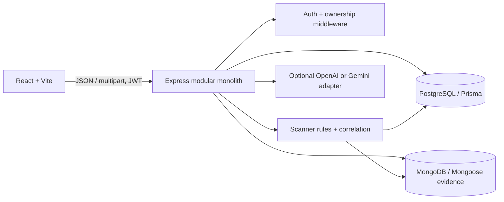

# Architecture

PostgreSQL owns relational application records. MongoDB stores flexible, redacted evidence, keyed by stable PostgreSQL scan IDs. The scanner is synchronous for this first local version and bounded by upload limits. It creates an observable `RUNNING` record, persists findings and scenarios transactionally, stores evidence, then changes status to `COMPLETED`. Any error is surfaced; cross-database failure triggers cleanup. An outbox worker is the recommended production evolution.

The modules currently live in `apps/api/src/server.ts` for HTTP composition, `apps/api/src/database/index.ts` for database models/connections, and `apps/api/src/scanner/engine.ts` for deterministic rule and relationship logic. The layout keeps the API a modular monolith while the feature set is small; route modules can be split without changing the boundaries.
